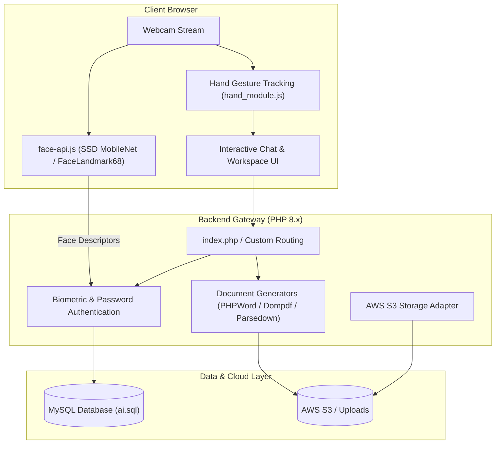

# ai.btoan.com — Interactive AI & Multimodal Web Workstation

[](https://www.php.net/)
[](https://developer.mozilla.org/en-US/docs/Web/JavaScript)
[](https://github.com/justadudewhohacks/face-api.js/)
[](https://aws.amazon.com/sdk-for-php/)

> The interactive web workstation and multimodal AI portal powering **[ai.btoan.com](https://ai.btoan.com)**. Combines client-side biometrics (facial landmark detection, face recognition), hand gesture tracking, generative document processing, and AI conversational workflows.

---

## 1. System Architecture



---

## 2. Key Features & Engineering Highlights

* **Biometric Face Authentication**:
  * Real-time client-side face detection using SSD MobileNet V1, 68-point facial landmark estimation, and 128-dimensional Euclidean face descriptor embeddings via `face-api.js`.
  * Enables passwordless biometric sign-in directly in the browser.
* **Computer Vision & Hand Gesture Interaction**:
  * Integrated `hand_module.js` for camera-based gesture recognition, allowing touchless UI interactions and interactive animations.
* **Dynamic Document & Report Generation**:
  * Converts Markdown and AI responses into formatted `.docx` files via `phpoffice/phpword` and downloadable PDFs via `dompdf/dompdf`.
  * Renders GitHub-flavored Markdown in real time using `erusev/parsedown`.
* **Cloud Storage & Asset Pipeline**:
  * Integrated AWS SDK for PHP for cloud-native asset storage and secure pre-signed upload URLs.
* **Database & Multi-Environment Web Serving**:
  * Normalized MySQL schema (`ai.sql`, `db.sql`) storing conversation histories, user profiles, and biometric descriptors.
  * Dual deployment support for Apache (`.htaccess`) and Microsoft IIS (`web.config`).

---

## 3. Tech Stack

| Domain | Technologies |
| :--- | :--- |
| **Backend** | PHP 8.1+, Composer |
| **Frontend** | Vanilla JavaScript (ES6+), CSS3 Animations, HTML5 Canvas |
| **Computer Vision / AI** | `face-api.js` (TensorFlow.js), MobileNet, Landmark68 models |
| **Document Processing** | `phpoffice/phpword`, `dompdf/dompdf`, `erusev/parsedown` |
| **Cloud & Storage** | AWS SDK for PHP (`aws/aws-sdk-php`), MySQL |
| **Web Server** | Apache (mod_rewrite / `.htaccess`) & IIS (`web.config`) |

---

## 4. Getting Started

### Prerequisites
- PHP 8.1+ with `pdo_mysql`, `curl`, `gd`, `mbstring` extensions
- [Composer](https://getcomposer.org/)
- MySQL 8.0+ / MariaDB
- Web server (Apache, Nginx, or PHP built-in server)

### Installation

```bash
# 1. Clone repository
git clone https://github.com/btoan2802/ai.btoan.com.git
cd ai.btoan.com

# 2. Install PHP dependencies
composer install

# 3. Import database schema
mysql -u root -p < ai.sql

# 4. Start local development server
php -S localhost:8000
```

Open `http://localhost:8000` in your web browser. Ensure camera permissions are granted for face and hand tracking modules.

---

## 5. Author & License

- **Author**: Nguyễn Bảo Toàn ([@btoan2802](https://github.com/btoan2802))
- **Website**: [ai.btoan.com](https://ai.btoan.com)
- **License**: MIT License

